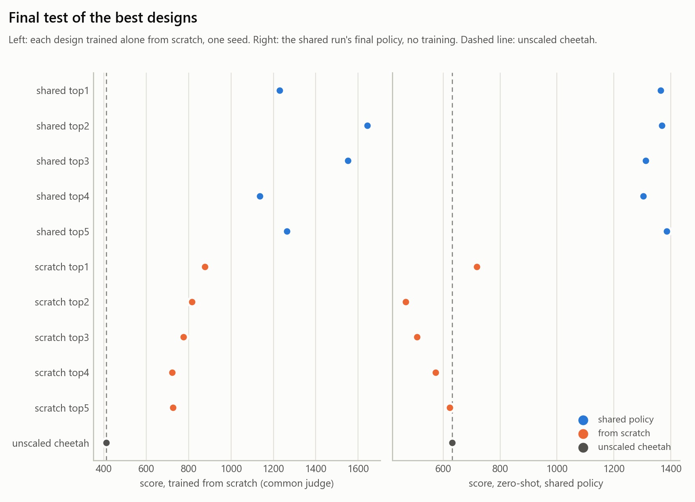

# Cheeta: morphology–behaviour co-adaptation in Isaac Lab

This repo reimplements the Half-Cheetah co-adaptation task of Luck, Ben Amor & Calandra,
*Data-efficient Co-Adaptation of Morphology and Behaviour with Deep Reinforcement Learning*
(CoRL 2019), in the GPU-parallel simulator Isaac Lab, using PPO from skrl in place of the paper's SAC.

A **design** is six scale factors `ξ ∈ [0.8, 2.0]` on the leg segment lengths
(`bthigh, bshin, bfoot, fthigh, fshin, ffoot`; base lengths 0.29 / 0.30 / 0.188 m per leg).
The goal is to find the design *and* the policy that run fastest. The reward is the paper's
design-independent `r = max(v_x / 10, 0)`.

What the repo provides:

- a **procedural asset pipeline** (design vector → URDF → USD → articulation), where each
  parallel env can hold a different morphology;
- a **design-conditioned general policy** that sees the design vector next to the 17-D state
  (the paper's population network);
- **evolutionary co-adaptation loops** in three variants: from-scratch training per candidate,
  screening with the general policy, and one shared policy trained on a whole population per
  generation;
- a **benchmark of cheap fitness proxies** (zero-shot return, critic value `V(s0)`, early
  learning-curve and PPO signals) against long-trained scores.

## Results so far



- **Shared policy vs. from scratch, at a matched budget** (≈4.8·10⁸ env transitions each,
  2026-11-16). Each run's 5 best designs were retrained alone from scratch as a common test.
  Shared-run designs scored 1137–1644 (mean 1365), from-scratch designs 723–876 (mean 783), and
  the unscaled cheetah 411. **This is one seed.** The shared policy also ranks designs only
  moderately well: Spearman ρ = 0.46 against from-scratch scores over 14 designs.
- **From-scratch evolution** (10 designs × 5 generations) raised the best score from 409 to 539.
  However, retraining the winners with new seeds showed that RL seed variance is as large as
  the differences between designs, and the unscaled cheetah was not beaten.
- **Synchronised resets** were one source of that variance: episodes end only by timeout, so
  every env resets on the same step. Starting training from random episode lengths
  (`--random-episode-start`) removed training collapses. With it, design rankings settle after
  about 400 PPO iterations.

Next step: retrain the final designs over several seeds and repeat the shared run with a
second seed.

## Setup

Requirements: Windows or Linux, an NVIDIA GPU, **Isaac Lab 2.3.2** with Isaac Sim 5.1.

1. Install Isaac Lab by following its
   [installation guide](https://isaac-sim.github.io/IsaacLab/main/source/setup/installation/index.html)
   (conda or uv is easiest).
2. Clone this repo outside the Isaac Lab directory and install the package in editable mode:

   ```
   python -m pip install -e source/cheeta
   ```

3. Optional: run `wandb login` once to enable `--wandb` logging.

**If your environment cannot import `isaacsim`**, the `AppLauncher` scripts fail on startup.
Use Isaac Sim's bundled Python instead and put the package on the path:

```
set PYTHONPATH=<repo>\source\cheeta
<IsaacLab>\_isaac_sim\python.bat -u scripts\...
```

Pass `-u` when redirecting output, because Kit exits without flushing stdout. The drivers launch
their workers with the same interpreter. The bundled Python has no matplotlib, so run the
`plot_*.py` scripts from any ordinary Python with matplotlib and numpy.

## Quick start

Every Isaac Sim script accepts the standard `AppLauncher` flags. Add `--headless` to run without
the viewer, which is much faster. The task is registered as `Template-Cheeta-Direct-v0`.

```
:: smoke test: 4 random designs over 8 envs, prints obs shape (8 x 23) and per-design distances
python scripts/check_multi_design.py --headless --num_envs 8 --designs 4

:: build and preview cheetahs with custom limb lengths
python scripts/make_cheeta.py --design 1.6 1.6 1.2 1.0 1.0 1.0 --preview
python scripts/make_cheeta.py --random 5 --preview

:: train the design-conditioned general policy (1-2 h)
python scripts/coadapt/train_general.py --phases 4 --designs-per-phase 64 --num_envs 512 --iterations 300 --wandb

:: evolution, every candidate trained from scratch with the same budget (clean design comparison)
python scripts/coadapt/evolve.py --generations 5 --population 10 --elites 4 --immigrants 0 ^
    --inherit scratch --elite-mode keep --no-identity --num_envs 1024 --iterations 200

:: evolution with one shared policy over a 1000-design population (~1 h 40 min)
python scripts/coadapt/evolve_shared.py --generations 10 --population 1000 --parents 100 ^
    --iterations-first 1000 --iterations 300 --wandb

:: shared vs from-scratch at a matched budget, followed by a common final test (~6 h)
python scripts/coadapt/compare_methods.py --out logs/coadapt/compare

:: watch a design with a trained checkpoint
python scripts/coadapt/play_design.py --design 1.2 0.9 1.0 1.4 1.0 0.8 --checkpoint <path>\agent.pt --real-time
```

All drivers resume an interrupted run when re-run with `--run-dir <old run>` (or `--out` for
`compare_methods.py`). Finished jobs are skipped. [docs/GUIDE.md](docs/GUIDE.md) documents every
flag, the screening-based `evolve.py` mode (`--general-checkpoint`, `--train-top`,
`--select-by`), the metric benchmark and the plotting scripts.

## How it fits together

```
designs.py ──► design_builder.py ──► cheeta_env.py (Template-Cheeta-Direct-v0)
 sample /        URDF → USD,           one design per env (design_set),
 mutate          cached per design     design vector appended to obs
                                            │
                     scripts/coadapt/train_design.py   ◄── worker: one Isaac Sim process,
                                            │              trains + scores with skrl PPO
       ┌──────────────────┬─────────────────┼──────────────────┬───────────────────┐
 train_general.py     evolve.py       evolve_shared.py   compare_methods.py   benchmark_metrics.py
 general policy       GA, per-design   GA, one shared     shared vs scratch    proxy metrics vs
 over random designs  fine-tuning      policy / gen       at matched budget    final scores
```

The drivers themselves don't import Isaac Sim. Each one starts one worker process per job,
because Isaac Sim cannot rebuild a scene in-process. Every job therefore pays a 30–45 s start-up,
and a 4000-env multi-design scene takes about 5 min to build.

## Repository layout

| Path | Contents |
|---|---|
| `source/cheeta/cheeta/designs.py` | design-vector helpers: bounds, sampling, mutation (no Isaac Sim needed) |
| `source/cheeta/cheeta/design_builder.py` | procedural planar Half-Cheetah: URDF generation, USD conversion, `ArticulationCfg` |
| `source/cheeta/cheeta/tasks/direct/cheeta/` | the direct RL env, its config (`CheetaEnvCfg`) and agent configs (skrl is the one in use) |
| `scripts/coadapt/` | co-adaptation drivers, the worker, the plotting scripts ([script reference](docs/GUIDE.md#script-reference)) |
| `scripts/skrl/` | plain single-design PPO train / play |
| `scripts/make_cheeta.py`, `check_multi_design.py`, `run_random_cheeta.py` | asset building and sanity checks |
| `scripts/rl_games/`, `rsl_rl/`, `sb3/`, `list_envs.py`, `zero_agent.py`, `random_agent.py` | utilities from the Isaac Lab template |
| `desin_builder.py`, `scripts/check_design_builder.py` | early generic asset-builder prototype, superseded by `design_builder.py` |
| `docs/` | guides and status notes (below); `docs/thesis/figures/` holds the report figures |

## Outputs and logging

- Runs write to `logs/coadapt/<timestamp>/` (gitignored), for example `history.csv`, `best.json`,
  per-generation `result.json` / `metrics.json` / `agent.pt` and the TensorBoard logs.
- Generated assets are cached per design in `%TEMP%\cheeta_assets\half_cheetah\<design>\`.
- `--wandb` logs to project `cheeta`, or `cheeta-shared` for `evolve_shared.py`. All runs of one
  driver share a group. Job types (`general-train`, `screen`, `candidate`, `benchmark`, `*-driver`)
  tell them apart. `--wandb-mode offline` works without a network connection.

## Caveats

- **Seed noise is large.** One training run per design does not rank designs reliably. Retrain
  the finalists over several seeds (`recheck_designs.py`) before drawing conclusions.
- Scores from before 2026-09-18 are not comparable with newer ones. Two bugs were fixed then:
  the skrl wrapper always reseeded to 0, and evaluation started mid-episode.
- Checkpoints from before the design-conditioned observation (17-D instead of 23-D) no longer load.
- With policy inheritance, scores rise over generations even if the designs don't improve. Use
  `--inherit scratch --elite-mode keep` in `evolve.py`, or the reference designs in
  `evolve_shared.py`, to measure design progress.

## Documentation

| Doc | For |
|---|---|
| [docs/GUIDE.md](docs/GUIDE.md) | full reference: env, reward, every workflow and flag, output formats |
| [docs/RUNNING.md](docs/RUNNING.md) | short checklist for running the pipeline |
| [docs/BRIEFING.md](docs/BRIEFING.md) | project status as of 2026-09-18 |
| [docs/DEMO.md](docs/DEMO.md) | meeting walkthrough of a small demo run and the metric benchmark |

The thesis chapter and the shared-vs-scratch report are LaTeX files in `docs/thesis/`. `.tex`
and `.bib` files are gitignored, so only the figures are committed.

## Development

- **VS Code:** run the task `setup_python_env` (`Ctrl+Shift+P` → *Tasks: Run Task*) and give it
  your Isaac Sim path. It writes `.vscode/.python.env` so that Isaac Sim modules are indexed.
- **Formatting:** `pip install pre-commit`, then `pre-commit run --all-files`.

The project started from the [Isaac Lab extension template](https://github.com/isaac-sim/IsaacLab),
which is why the task id still carries the `Template-` prefix.

## Reference

K. S. Luck, H. Ben Amor, R. Calandra. *Data-efficient Co-Adaptation of Morphology and Behaviour
with Deep Reinforcement Learning.* Conference on Robot Learning (CoRL), 2019.
